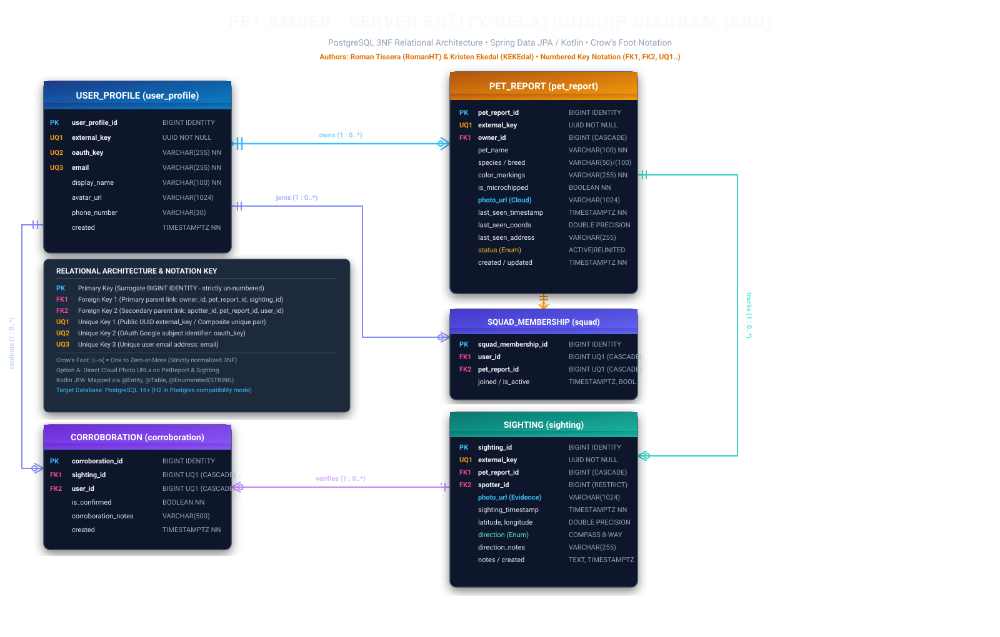



## Page contents
{:.no_toc}

- ToC
{:toc}

## Summary

Pet Amber is a collaborative, community-driven emergency broadcast and search coordination platform designed to quickly reunite missing pets with their families. When a pet goes missing, every hour is critical; traditional physical flyers and disconnected social media posts often lead to delayed, fragmented, or conflicting information. Pet Amber solves this by combining a native Android client with a centralized Spring Boot cloud web service to mobilize neighborhood search parties in real time.

Pet owners can broadcast an urgent "Pet Amber" alert complete with identifying photos, distinctive traits, and the exact last-seen GPS location. Nearby neighbors can join the pet's active "Search Squad" to follow the case, submit timestamped sightings with photos and direction of travel, and corroborate or upvote each other's sightings. By aggregating these community contributions in a central database, Pet Amber generates a chronological sighting timeline and breadcrumb trail that helps owners pinpoint their pet's movements and bring them home safely.

## Intended users and user stories

### Distressed Pet Owner
* As a pet owner, I want to broadcast an urgent Pet Amber alert with photos, distinctive markings, and last-seen GPS coordinates, so that nearby community members can immediately be on the lookout.
* As a pet owner, I want to view a chronological timeline and breadcrumb trail of all reported sightings, so that I can see the direction my pet is traveling and deploy search efforts effectively.
* As a pet owner, I want to mark an alert as resolved and publish a reunion update, so that search squad members know our pet is safe and their efforts are acknowledged.

### Neighborhood Volunteer / Search Squad Member
* As a neighborhood volunteer, I want to join the Search Squad for a missing pet in my area, so that I receive updates on new sightings and actively assist in coordinating ground search efforts.
* As a volunteer, I want to corroborate and upvote sightings logged by other neighbors, so that we can validate accurate leads and eliminate false alarms for the owner.

### Local Spotter / Good Samaritan
* As a local spotter who sees a stray animal, I want to quickly capture a photo, geotag my current GPS location, and record the animal's direction of travel, so that the owner receives an immediate, actionable lead.
* As a community member, I want to browse an interactive feed of active pet alerts in my neighborhood, so that I stay informed about missing animals near my home or daily commute.

## Functionality

* **User Authentication & Identity:** Secure user sign-in via Google OAuth 2.0 / OpenID Connect, establishing a verified user profile across sessions without requiring custom password management.
* **Pet Amber Alert Creation:** Guided creation flow allowing owners to upload pet photos, set species, breed, distinctive markings, collar details, microchip status, and mark the initial last-seen location on a map.
* **Search Squad Mobilization:** A one-click "Join Search Squad" interaction that subscribes users to an active case, tracking who is actively assisting in the search.
* **Geotagged Sighting Submission:** A streamlined form for spotters to log a sighting directly against an active alert, incorporating device camera photos, device GPS coordinates, timestamp, direction of travel (e.g., North, Southeast), and contextual notes.
* **Sighting Corroboration & Upvoting:** Community members can confirm or upvote reported sightings (e.g., *"Confirmed, saw this dog near 4th & Lomas at 3:15 PM"*), creating a trust score and filtering false leads.
* **Dynamic Alert & Sighting Feeds:** Material Design `RecyclerView` lists displaying:
  * A searchable, status-filtered feed of active neighborhood Pet Amber alerts.
  * A chronological breadcrumb timeline of sightings for any selected pet report.
* **Interactive Map / Breadcrumb Trail:** Visual display pinning the initial lost location alongside sequential community sighting markers.
* **Case Resolution & Reunion Status:** Ability for the pet owner to transition the alert state from `ACTIVE_SEARCH` to `RESOLVED` or `CLOSED`, archiving the report while preserving historical data.

## Persistent data

All persistent application data is maintained centrally in a relational database (PostgreSQL) managed by Spring Data JPA on the backend server:

* **User Accounts (`User`):** Stores Google subject identifier (OAuth ID), display name, email address, profile avatar URL, and creation timestamp.
* **Pet Alerts (`PetReport`):** Stores reference to the owning user, pet name, species, breed, color/markings description, collar/tag details, microchip flag, primary photo storage URL, last-seen timestamp, last-seen latitude and longitude, status (`ACTIVE_SEARCH`, `RESOLVED`, `ARCHIVED`), and resolution notes.
* **Search Squad Memberships (`SquadMembership`):** Associative entity linking `User` and `PetReport` with enrollment timestamp, tracking which users have mobilized for an active search.
* **Sightings (`Sighting`):** Stores foreign key reference to `PetReport`, reference to the reporting `User`, sighting timestamp, GPS latitude and longitude, evidence photo URL, direction of travel, and descriptive notes.
* **Sighting Corroborations (`Corroboration`):** Associative entity linking a verifying `User` to a `Sighting` with corroboration timestamp, confirmation status (confirmed vs. rejected/disputed), and optional corroborating notes.

## Device/external services

### Client Device Platform Services
* **Camera API / Photo Picker:** Captures real-time camera photos of missing pets or spotter sightings, and accesses device storage for existing pet photos.
* **Location Services (FusedLocationProviderClient / GPS):** Automatically retrieves precise device latitude and longitude coordinates when reporting a last-seen point or a new sighting.

### External Cloud Services & APIs
* **Google Identity Services (OAuth 2.0 / OpenID Connect):** Authenticates users on the Android client and issues identity tokens validated by the Spring Boot backend.
* **Mapping & Geocoding Services (Google Maps SDK or OpenStreetMap):** Renders interactive map views, visualizes alert pins, and plots breadcrumb sighting trails.
* **Cloud Media Storage (e.g., Firebase Storage or Cloudinary):** Hosts uploaded pet profile images and sighting evidence photos referenced by the database.

## Stretch goals and possible enhancements

The following enhancements represent organic extensions to the core architecture, ordered from least to most complex:

1. **Local Offline Sighting Caching (Google Room ORM):** Cache reported sightings locally on the device via SQLite/Room so spotters in areas with intermittent cellular coverage can draft sightings that sync automatically once connectivity is restored.
2. **Radius-Based Proximity Push Notifications:** Utilize Firebase Cloud Messaging (FCM) to broadcast push notifications to users whose saved home radius or current location falls within 2–3 miles of a newly initiated Pet Amber alert.
3. **Emergency Foster & Microchip Scanner Directory:** Allow community members to register special volunteer capabilities on their profile (e.g., holding a universal microchip scanner or offering temporary overnight foster care for animals found outside shelter hours).
4. **Real-Time Map Synchronization:** Integrate WebSocket or Server-Sent Events (SSE) to update the breadcrumb map and sighting count live on connected devices as new sightings are confirmed by the search squad.

## Database Entity-Relationship Diagram (ERD) & DDL

* [**Pet Amber Server ERD Specification (PDF)**](pdf/Pet_Amber_Server_ERD_Specification.pdf) — Complete 2-page specification covering relational schema matrices, multiplicity, 3NF multi-user cascade behaviors, and data dictionary.
* [**Executable PostgreSQL DDL Script**](sql/ddl.sql) — Clean executable database definition statements with check constraints, foreign keys, and indices.
* [**Visual Vector Diagram (SVG)**](img/erd.svg) | [**High-Resolution Diagram (PNG)**](img/erd.png)

### Visual Schema (Crow's Foot Notation)



### Mermaid ERD Source Code

```mermaid
erDiagram
  USER_PROFILE ||--o{ PET_REPORT : "owns (1 : 0..*)"
  USER_PROFILE ||--o{ SQUAD_MEMBERSHIP : "joins (1 : 0..*)"
  PET_REPORT ||--o{ SQUAD_MEMBERSHIP : "mobilizes (1 : 0..*)"
  PET_REPORT ||--o{ SIGHTING : "tracks (1 : 0..*)"
  USER_PROFILE ||--o{ SIGHTING : "spots (1 : 0..*)"
  SIGHTING ||--o{ CORROBORATION : "verifies (1 : 0..*)"
  USER_PROFILE ||--o{ CORROBORATION : "confirms (1 : 0..*)"

  USER_PROFILE {
    BIGINT user_profile_id PK "IDENTITY"
    UUID external_key UQ1 "NOT NULL, UNIQUE"
    VARCHAR oauth_key UQ2 "Google sub NOT NULL, UNIQUE"
    VARCHAR display_name "NOT NULL"
    VARCHAR email UQ3 "NOT NULL, UNIQUE"
    VARCHAR avatar_url "NULL"
    VARCHAR phone_number "NULL"
    TIMESTAMPTZ created "NOT NULL DEFAULT CURRENT_TIMESTAMP"
  }
  PET_REPORT {
    BIGINT pet_report_id PK "IDENTITY"
    UUID external_key UQ1 "NOT NULL, UNIQUE"
    BIGINT owner_id FK1 "REFERENCES user_profile (CASCADE)"
    VARCHAR pet_name "NOT NULL"
    VARCHAR species "NOT NULL"
    VARCHAR breed "NULL"
    VARCHAR color_markings "NOT NULL"
    VARCHAR collar_description "NULL"
    BOOLEAN is_microchipped "NOT NULL DEFAULT FALSE"
    VARCHAR photo_url "NULL (Cloud Storage Image)"
    TIMESTAMPTZ last_seen_timestamp "NOT NULL"
    DOUBLE_PRECISION last_seen_latitude "NOT NULL"
    DOUBLE_PRECISION last_seen_longitude "NOT NULL"
    VARCHAR last_seen_address "NULL"
    VARCHAR status "NOT NULL (ACTIVE_SEARCH | REUNITED | CLOSED)"
    TEXT resolution_notes "NULL"
    TIMESTAMPTZ created "NOT NULL"
    TIMESTAMPTZ updated "NOT NULL"
  }
  SQUAD_MEMBERSHIP {
    BIGINT squad_membership_id PK "IDENTITY"
    BIGINT user_id FK1 "REFERENCES user_profile (CASCADE, UQ1)"
    BIGINT pet_report_id FK2 "REFERENCES pet_report (CASCADE, UQ1)"
    TIMESTAMPTZ joined "NOT NULL DEFAULT CURRENT_TIMESTAMP"
    BOOLEAN is_active "NOT NULL DEFAULT TRUE"
  }
  SIGHTING {
    BIGINT sighting_id PK "IDENTITY"
    UUID external_key UQ1 "NOT NULL, UNIQUE"
    BIGINT pet_report_id FK1 "REFERENCES pet_report (CASCADE)"
    BIGINT spotter_id FK2 "REFERENCES user_profile (RESTRICT)"
    VARCHAR photo_url "NULL (Evidence Image)"
    TIMESTAMPTZ sighting_timestamp "NOT NULL"
    DOUBLE_PRECISION latitude "NOT NULL"
    DOUBLE_PRECISION longitude "NOT NULL"
    VARCHAR location_description "NULL"
    VARCHAR direction "Enum: NORTH..STATIONARY"
    VARCHAR direction_notes "Free-form text"
    TEXT notes "NULL"
    TIMESTAMPTZ created "NOT NULL"
  }
  CORROBORATION {
    BIGINT corroboration_id PK "IDENTITY"
    BIGINT sighting_id FK1 "REFERENCES sighting (CASCADE, UQ1)"
    BIGINT user_id FK2 "REFERENCES user_profile (CASCADE, UQ1)"
    BOOLEAN is_confirmed "NOT NULL DEFAULT TRUE"
    VARCHAR corroboration_notes "NULL"
    TIMESTAMPTZ created "NOT NULL"
  }
```
